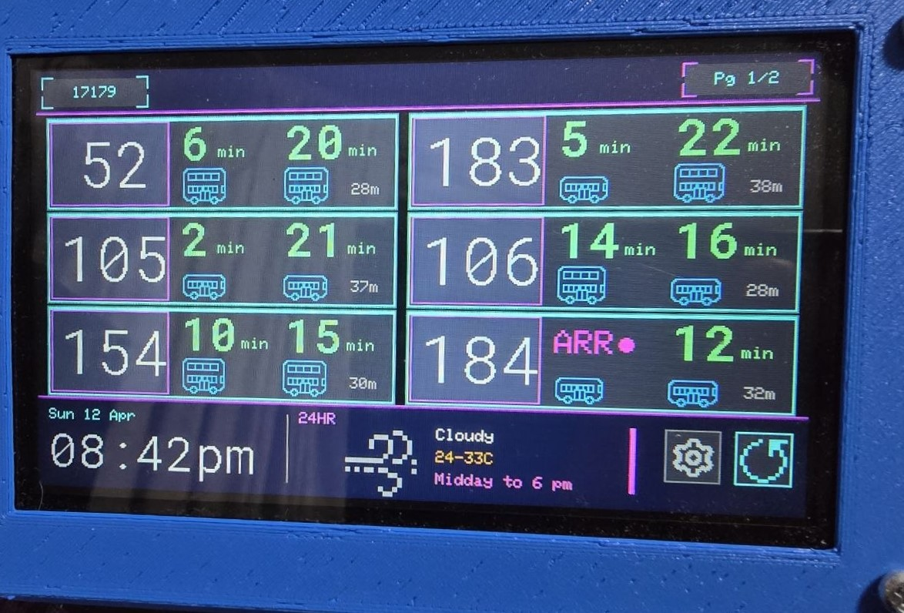

# Bus Butler

Firmware for a bus arrival and weather forecast IoT device that runs on the JC4827W543 board (GUITION 4.3 inch ESP32 LCD module).

This firmware is specifically for the capacitive touch panel variant. It targets the following hardware stack:
- **MCU:** ESP32-S3 dual 240MHz Cores
- **Flash:** 4MB
- **LCD Controller:** `NV3041A`
- **Touch Controller:** `GT911`
- **Screen Resolution:** 480x272 LCD

> [!CAUTION]
> There are no stability guarantees in this firmware, use at your own risk.

# Demo Deployment



# External Dependencies

- [LTA Datamall](https://datamall.lta.gov.sg/content/datamall/en.html) for bus arrival data
- NEA datasets on [data.gov.sg](https://data.gov.sg) for weather forecasts
- [bus.gov.sg](https://bus.gov.sg) for web continuity

# Using the device

| Where | Gesture | What it does |
| --- | --- | --- |
| Anywhere | Swipe left / right | Move between Home, Weather, MRT and Status |
| Anywhere | Pull down from the top edge | Controls: brightness, auto-dim, night dim, refresh, web portal QR |
| Home, bus stop header | Swipe left / right | Switch between saved bus stops |
| Home, bus list | Swipe up / down | Next / previous page of services |
| Home, bus list | Tap | Full-screen QR for the stop on bus.gov.sg |
| Home, clock and weather | Tap | Open the Weather page |
| Home, MRT banner | Tap | Open the MRT page (the banner only appears during disruptions) |

Pages slide in and out, the controls panel slides down from the top, the bus list pushes up or down between pages, the backlight fades when dimming or waking, and an arriving bus's dot pulses. The Status page shows the measured animation frame rate.

Settings (bus stops, service order, dimming, weather town and region, WiFi, API key) are in the web portal at `http://busbutler.local` or the device's IP address. The Controls panel can show a QR code for it.

# Data sources

- LTA DataMall: bus arrivals, bus stop names (BusStops), MRT disruptions (TrainServiceAlerts)
- data.gov.sg (NEA): 2-hour, 24-hour and 4-day forecasts; air temperature, humidity and rainfall from the station nearest the configured town; PSI for the configured region; UV index

# Building

```
cd web-portal && npm ci && npm run build && cd ..
pio run -t upload
```

The firmware uses a custom `partitions.csv`: one 2.5 MB app slot (no OTA) with NVS and SPIFFS at the stock `default.csv` offsets and sizes. The first upload after changing partition tables must be a full `pio run -t upload` so the table is rewritten. Saved settings are kept.

UI fonts are generated into `src/Ui/Fonts/` by `scripts/generate_fonts.py` (Figtree, Space Grotesk and Material Icons, converted the same way as Adafruit's `fontconvert`). See the script header to regenerate them.
